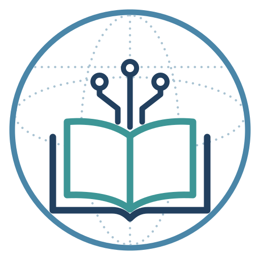

<p align="center"></p>

# AI Skills Without Borders

**Shared AI skills for medical and biomedical-research educators.**

A community library of *Agent Skills* — packaged instructions that teach an AI assistant to do a specific teaching task well: write learning objectives, build a PBL session, turn a paper into a pre-reading, build a syllabus, check a lesson plan, write exam questions.

Each skill is a folder with a `SKILL.md` file in the open [Agent Skills](https://agentskills.io) format. The same folder works in Claude, ChatGPT (Business / Enterprise / Edu), Gemini Enterprise, Microsoft 365 Copilot (Cowork, Copilot Studio) and coding agents (Claude Code, Codex, Gemini CLI, GitHub Copilot). For personal plans without skill support, every skill also comes as a paste-in version for a GPT, Gem or Project.

> Founded by educators at the Gutwirth Medical School (Weizmann Institute of Science) and the Icahn School of Medicine at Mount Sinai. Open to every institution.

## The skills

<!-- CATALOG:START -->
| Skill | What it does | Runs code | Maturity |
|---|---|---|---|
| [learning-objectives-designer](skills/learning-objectives-designer) | Extracts, writes, splits, levels and maps learning objectives; produces the numbered objectives table the other skills use. | No | draft |
| [pbl-rbl-session-builder](skills/pbl-rbl-session-builder) | Design partner for case-based PBL and tool-based RBL sessions, with readers, quizzes and intro lectures. | No | tested at origin |
| [reading-material-generator](skills/reading-material-generator) | Turns papers and chapters into session-sized interactive readings with glossary, reflection prompts and self-checks. | No | tested at origin |
| [exam-question-writer](skills/exam-question-writer) | Blueprints and writes objective-aligned SBA, short-answer and data-interpretation items, checked for item-writing flaws. | No | draft |
| [lesson-format-checker](skills/lesson-format-checker) | Checks lesson plans and Jupyter assignment notebooks against a house-style profile and applies only approved fixes. | Optional | draft |
| [syllabus-builder](skills/syllabus-builder) | Builds or updates a syllabus from partial course material, with an evidence-based (E/P/X) map to any competency framework. | No | draft |
<!-- CATALOG:END -->

The skills work together around one shared artefact — the **objectives table**:

```
learning-objectives-designer ──► objectives table (O1, O2, …)
        │
        ├──► syllabus-builder          (places objectives, maps competencies)
        ├──► pbl-rbl-session-builder   (sessions serve objective IDs)
        ├──► reading-material-generator(readings serve objective IDs)
        ├──► exam-question-writer      (one item = one objective ID)
        └──► lesson-format-checker     (lesson plans list objective IDs)
```

## Install

See **[docs/install.md](docs/install.md)** for step-by-step instructions per tool. Quick versions:

- **Claude Code:** `/plugin marketplace add ai-skills-without-borders/skills` then `/plugin install ai-skills-without-borders@ai-skills-without-borders`
- **Claude.ai, ChatGPT, Gemini Enterprise, Copilot Cowork:** download a skill's ZIP from the [catalog site](https://ai-skills-without-borders.github.io/skills/) and upload it in the tool's Skills settings.
- **Any assistant (free/personal plans):** use the skill's paste-in version as the instructions of a GPT, Gem or Project.

## Principles

Every skill in this library:

1. **Never invents** sources, citations, figures, names, dates or framework wording. Missing → a visible placeholder or a question.
2. **Treats the educator as the expert.** It proposes; the educator approves. Competency mappings are proposals — the AAMC asks that no external competency set be used without faculty review.
3. **Is transparent about AI use.** Outputs carry a one-line AI-assistance statement in the institution's wording.
4. **Protects privacy.** No identifiable patient or learner data, ever.
5. **Is tool-agnostic.** Nothing depends on one AI product. Skills that run code say so and degrade gracefully where code can't run.
6. **Is evidence-labelled.** Each skill's card says where it has been tested and by whom (see [GOVERNANCE.md](GOVERNANCE.md)).

These align with the AAMC *Principles for the Responsible Use of AI in and for Medical Education*.

## Contribute

- **Used a skill?** File a [usage report](community/usage-report.md) — it's the most valuable contribution. It tells others where a skill works.
- **Have a skill?** See [CONTRIBUTING.md](CONTRIBUTING.md). You don't need to know GitHub: send it through the submission form and a maintainer will add it.
- **Running a workshop?** Use the [round-table protocol](community/roundtable-protocol.md).

## Repository layout

```
skills/<skill>/SKILL.md      the skill (what the AI reads)
skills/<skill>/card.yaml     the skill card (maturity, testing, authors)
skills/<skill>/references/   detail the skill loads on demand
frameworks/                  how to supply a competency framework
community/                   usage reports, review checklist, workshop protocol
docs/                        catalog site (GitHub Pages) and install guide
dist/                        built ZIPs and paste-in versions (generated)
tools/build.py               validates skills and builds dist/ and the site
```

## License

Skill content: [CC BY 4.0](LICENSE). Scripts: [MIT](LICENSE-CODE). Cite the library with [CITATION.cff](CITATION.cff); each release gets a DOI via Zenodo.
